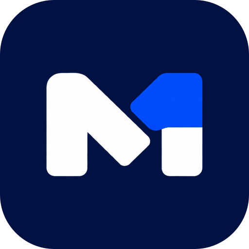

<picture>
  <source media="(prefers-color-scheme: dark)" srcset="assets/fishware-oscuro.png">
  
</picture>

### Hola, soy Raúl Fisher — fundador de **FishWare** 👋

Startup mexicana 🇲🇽 que crea software para negocios de verdad: 
los que cobran en efectivo, tienen el internet que a veces se cae y necesitan que alguien les conteste.

---

## 🚀 Lo que construimos

<table>
  <tr>
    <td width="50%" valign="top">
      
      <b><a href="https://mercadia.mx">Mercadia</a></b> 
      Punto de venta e inventario para comercios · <a href="https://mercadia.mx">mercadia.mx</a>
        
      Un mismo sistema que se adapta al giro: cafetería, restaurante, carnicería, ferretería, papelería, taller, consultorio dental o venta en línea. Caja, inventario, pedidos, mesas, citas y reparaciones.
    </td>
    <td width="50%" valign="top">
      <b>🧩 Software a la medida</b> 
      Para lo que todavía no existe
        
      Sistemas de gestión, aplicaciones web y móviles, tiendas en línea y páginas para negocios. Con la misma forma de trabajar que nuestros productos: pruebas, seguridad y trato directo con quien lo construyó.
    </td>
  </tr>
</table>

<b>Cómo están hechos por dentro</b>

 

- **Varios negocios en una sola base, cada quien con lo suyo:** el aislamiento lo impone PostgreSQL (Row Level Security), no solo el código.
- **Tiempo real** con Server-Sent Events: el soporte y los avisos se actualizan solos en todas las pantallas.
- **Nada de cobrar dos veces:** las operaciones de dinero bloquean la fila (`SELECT … FOR UPDATE`) y tienen pruebas de concurrencia.
- **Cientos de pruebas automáticas** contra la base real con Vitest.
- **Seguridad:** contraseñas con scrypt, sesiones opacas, freno de intentos de inicio de sesión, rotación de tokens con detección de robo.

## 🛠️ Con qué trabajo

**Producto** 

**Datos y servidor** 

**Donde empecé: scripts para FiveM** 

---

¿Tienes un negocio y quieres ordenarlo? Escríbeme a <b>fisherware2026@gmail.com</b>.

