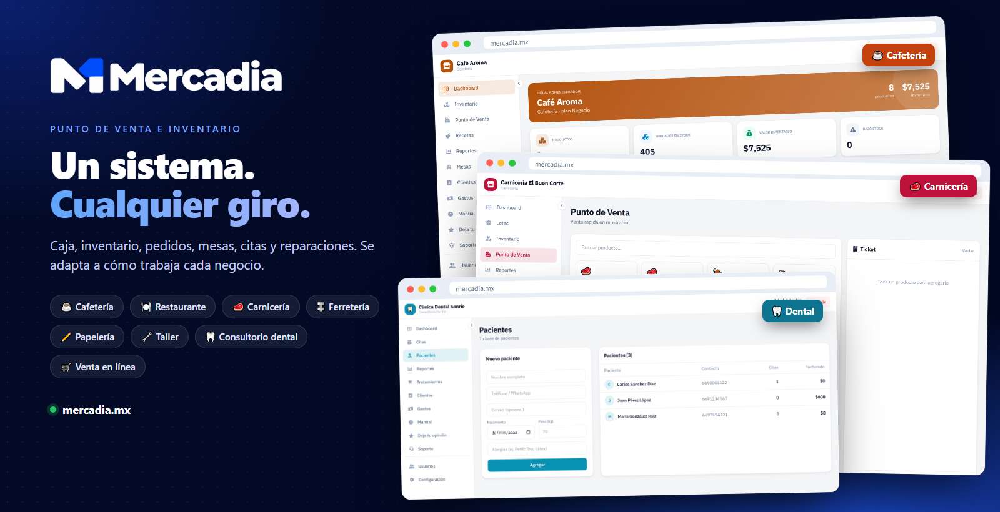

### Hola, soy Raúl 👋

Soy fundador de **FishWare**, una startup mexicana de Poza Rica, Veracruz, que crea software para los negocios
que el software de siempre olvida: los que cobran en efectivo, tienen el internet que a veces se cae y necesitan que alguien les conteste.

En FishWare tenemos **productos propios**, como Mercadia, y también hacemos **software a la medida** para otros negocios.
Lo diseñamos, lo programamos, lo ponemos en marcha y le damos soporte nosotros mismos.

 

## 🛒 Mercadia · producto de FishWare

**Punto de venta e inventario que se adapta al giro.** El mismo sistema se convierte en lo que cada negocio necesita:
mesas y comandas para la cafetería, lotes y merma para la carnicería, citas y pacientes para el consultorio dental.

| | |
|---|---|
| 💵 **Caja y ventas** | Cobro rápido en mostrador, cortes de caja y gastos. |
| 📦 **Inventario** | Existencias, variantes, alertas de bajo stock y valor del inventario al momento. |
| 🍽️ **Según el giro** | Mesas, recetas, lotes, merma, citas, pacientes y reparaciones. |
| 📊 **Reportes** | Lo que se vendió, lo que se gastó y lo que queda. |
| 🎧 **Soporte adentro** | El negocio escribe desde el sistema y le contesta una persona. |

**[Pruébalo en mercadia.mx →](https://mercadia.mx)**

 

## 🧩 Software a la medida · servicio de FishWare

¿Lo que tu negocio necesita todavía no existe? En FishWare lo construimos: **sistemas de gestión, apps web y móviles, tiendas en línea y páginas para negocios**,
con la misma forma de trabajar que nuestros productos: pruebas automáticas, seguridad desde el principio y trato directo con quien lo programó.

 

## ⚙️ Cómo construimos en FishWare

<table>
<tr>
<td width="50%" valign="top">

**🏢 Varios negocios, una sola base** 
Cada negocio ve solo lo suyo. El aislamiento lo impone PostgreSQL con Row Level Security, no solo el código.

</td>
<td width="50%" valign="top">

**⚡ Tiempo real** 
Soporte y avisos con Server-Sent Events: todas las pantallas se actualizan solas.

</td>
</tr>
<tr>
<td valign="top">

**💸 Nada de cobrar dos veces** 
Las operaciones de dinero bloquean la fila (<code>SELECT … FOR UPDATE</code>) y tienen pruebas de concurrencia.

</td>
<td valign="top">

**🔐 Seguridad** 
Contraseñas con scrypt, sesiones opacas, freno de intentos y rotación de tokens con detección de robo.

</td>
</tr>
<tr>
<td colspan="2" valign="top">

**🧪 Cientos de pruebas automáticas** 
Corren con Vitest contra la base de datos real, más pruebas de navegador de punta a punta.

</td>
</tr>
</table>

 

## 🛠️ Con qué trabajo

Donde empecé: scripts para FiveM 

  

### ¿Tienes un negocio y quieres ordenarlo?

**Escríbeme a [fisherware2026@gmail.com](mailto:fisherware2026@gmail.com)** · [fishware.mx](https://fishware.mx)

